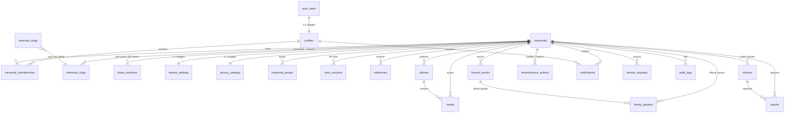

# Evermora data model (Phase 2 foundation)

Authoritative schema: [`supabase/migrations/`](../../supabase/migrations), applied
with the Supabase CLI. This document explains the model those migrations create.
It is a **foundation** — product features are not built yet.

## Design rules

- **Relational, not a JSON blob.** Every memorial concern is its own table with
  proper keys, foreign keys, `check` constraints and indexes.
- **Identity ≠ address.** A memorial's identity is its immutable `memorials.id`
  (UUID). The public slug lives in `memorial_slugs` and can change without
  touching identity. See [memorial-url-architecture.md](./memorial-url-architecture.md).
- **Authentication ≠ authorization.** `auth.users → profiles → memorial_memberships
→ memorials`. Roles are vocabulary; the permission mapping lives in
  `app.has_memorial_permission()`. See [authorization-architecture.md](./authorization-architecture.md).
- **Soft delete** via `deleted_at timestamptz` on user-content tables; hard
  delete is reserved and guarded.
- **Timestamps**: `created_at` + `updated_at` (kept current by the
  `app.set_updated_at()` trigger) on every mutable table.
- **Enums** for small closed product vocabularies; `text` + `check` for
  free-form or provider-driven values.
- **`app` schema** holds SECURITY DEFINER helper functions used by RLS. It is
  not exposed through the Data API.

## Entity–relationship overview



## Table responsibilities

| Table                  | Responsibility                              | Key points                                                                                                                                                  |
| ---------------------- | ------------------------------------------- | ----------------------------------------------------------------------------------------------------------------------------------------------------------- |
| `profiles`             | Application-level user record               | PK = `auth.users.id`; **no credentials**; `is_platform_admin` flag (guarded); auto-created by `app.handle_new_user()`                                       |
| `memorials`            | Core memorial                               | `status` (draft/published/archived/suspended/deleted) **independent of** `funeral_planning_status`; `check` on date order and `published_at`                |
| `memorial_people`      | Family / relations shown on a memorial      | Content only — not platform users                                                                                                                           |
| `memorial_memberships` | profile ⇄ memorial authorization edge       | `role` + `status`; unique active membership per profile; **exactly one active `owner`** (partial unique index); creator auto-becomes owner                  |
| `reserved_slugs`       | Root-namespace words unavailable as slugs   | Seeded (~70 entries); enforced by trigger, not just UI                                                                                                      |
| `memorial_slugs`       | Every slug a memorial ever had              | Exactly one `is_canonical`; others are 301 aliases; `retired_at`; grammar + reserved check in a trigger                                                     |
| `share_resolvers`      | Permanent QR / print identifiers            | `token` (unguessable) → memorial → current canonical slug; survives slug changes                                                                            |
| `story_sections`       | Life-story content blocks                   | `kind` enum, `status`, per-section `visibility`                                                                                                             |
| `milestones`           | Dated life events for the timeline          | `year` (+ optional `on_date`, year must match), `status`, `visibility` — same `story` privacy toggle & `story.edit` write rule as story_sections (Phase 5E) |
| `albums`               | Named media groupings                       | `status`, `visibility`, `cover_media_id`                                                                                                                    |
| `media`                | Every uploaded asset (metadata)             | `storage_bucket` + `storage_path` unique; path is `{memorial_id}/…`; `source` (family/tribute/admin); `processing_status`                                   |
| `tributes`             | Visitor tributes (no account needed)        | `status` default `pending`; `author_email` **private**; anon reads go through the `public_tributes` view                                                    |
| `funeral_events`       | Multiple event records per memorial         | `event_type` + `status`; draft events never public; lat/long `check`                                                                                        |
| `family_updates`       | Official family notices                     | `importance`; optional `funeral_event_id`; `status`                                                                                                         |
| `remembrance_actions`  | Visitor gestures (candle/flower/…)          | No account; `visitor_session` soft de-dupe; public reads via `remembrance_action_counts` view                                                               |
| `feature_settings`     | Per-memorial capability toggles             | 1 row/memorial (trigger); safe defaults (§ [privacy-architecture.md](./privacy-architecture.md))                                                            |
| `privacy_settings`     | Visibility + per-section privacy + indexing | `visibility` (private/anyone_with_link/public); `search_indexing_enabled` default **false**                                                                 |
| `service_requests`     | Evermora-facilitated service enquiries      | May precede a memorial; `internal_notes` platform-only; requester view `my_service_requests`                                                                |
| `notifications`        | Provider-agnostic notification events       | `event_type` vocabulary only; `sent_at` set by a future delivery adapter                                                                                    |
| `reports`              | Abuse / accuracy / privacy reports          | Anyone (incl. anon) can file; platform staff resolve                                                                                                        |
| `audit_logs`           | Append-only trail of consequential actions  | No `UPDATE`/`DELETE` (revoked + no policy); some rows written by triggers                                                                                   |

## Enumerated types

`memorial_status`, `funeral_planning_status`, `memorial_visibility`,
`section_visibility`, `memorial_role`, `membership_status`, `tribute_status`,
`publication_status`, `funeral_event_type`, `funeral_event_status`,
`story_section_kind`, `media_kind`, `media_source`, `media_processing_status`,
`update_importance`, `remembrance_action_type`, `service_request_type`,
`service_request_status`, `notification_event_type`, `notification_channel`,
`report_reason`, `report_status`, `audit_actor_kind`.

The TypeScript mirrors of the product-facing enums live in `@evermora/types`
(`packages/types/src/memorial.ts`, `roles.ts`).

## Constraints & integrity highlights

- `memorials_dates_order` — `date_of_death >= date_of_birth` when both set.
- `memorials_published_has_timestamp`, `tributes_approved_has_timestamp`,
  `funeral_events_published_has_timestamp` — status implies its timestamp.
- `memorial_memberships_one_active_owner` — partial unique index.
- `memorial_slugs` — unique `slug`; one canonical per memorial; grammar enforced
  by `app.slug_is_valid()` + `reserved_slugs` lookup in `app.memorial_slugs_validate()`.
- `media_storage_path_unique` — `(storage_bucket, storage_path)`.
- Trigger guards (`supabase/migrations/…_guards.sql`): protect `is_platform_admin`,
  auto-grant creator ownership, gate memorial soft-delete / suspension, protect
  the last active owner.

## Rebuilding from migrations

```bash
supabase db reset      # drops, replays every migration in supabase/migrations, runs seed
supabase db diff       # must report: "No schema changes found"
```

`supabase db diff` reporting no drift is the check that the committed migrations
fully describe the database.
